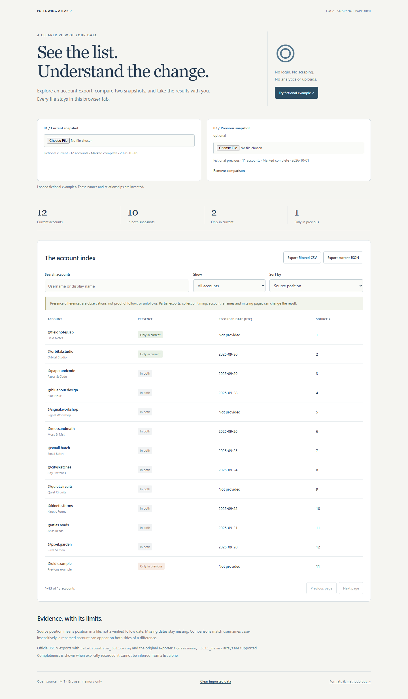

# Following Atlas

A local snapshot explorer for Instagram account exports. Search and sort a list, compare two snapshots, inspect data quality, and export the current view as CSV or normalized JSON. No login, server, analytics, or upload is involved.



[Open the viewer](https://ashwin-iyer1.github.io/insta_following_order/) or run locally:

```sh
python -m http.server 8832 --bind 127.0.0.1
```

Open <http://127.0.0.1:8832>. Choose **Try fictional example**, or import JSON files already on your computer. The example is invented. Files are read with the browser File API, stay in tab memory, and disappear on reload or **Clear imported data**. The page's content policy blocks network connections. Links to GitHub navigate only when clicked.

## What the comparison means

Usernames are matched case-insensitively: **In both**, **Only in current**, and **Only in previous** are presence differences, not proof of follows or unfollows. Partial collection, renames, missing pages and capture times can explain differences. Renamed accounts are not identified.

**API response order is not verified follow chronology.** The earlier “most recently followed → oldest” claim was unsupported and has been removed. Source position is the row position in a file. Dates appear in UTC only when an integer Unix timestamp is present; missing/invalid dates stay missing. Completeness is shown only when explicitly recorded, not guessed from row counts.

## Supported files

- Original exporter arrays: `[{"username":"example","full_name":"Example"}]`.
- Instagram JSON account-export objects containing `relationships_following`, with `title` and/or `string_list_data` records containing `value` and `timestamp`.
- Normalized `following-snapshot/v1` files:

```json
{
  "schema": "following-snapshot/v1",
  "source": "my-export",
  "capturedAt": "2026-10-16T12:00:00Z",
  "complete": null,
  "accounts": [{"username":"example","full_name":"Example","timestamp":null}]
}
```

`complete` is `true`, `false`, or `null` (unknown). `capturedAt` is a capture timestamp, distinct from record timestamps. A source's `true` claim appears as **Marked complete**, not independently verified. Duplicates retain the first valid record; invalid rows and missing dates are counted in normalized metadata. Limits: 10 MiB and 50,000 input records. The table renders 50 rows per page; CSV includes all matching rows across pages. Formula-like spreadsheet values are escaped. Imported text is never rendered as HTML.

**Export current JSON** preserves the current snapshot, not a merged list from different times. **Export filtered CSV** includes comparison statuses and the active search/filter results. No personal exports are committed.

## Optional legacy console exporter

`fetch_following_list.js` and its reproducible minified counterpart remain an experimental manual collector. The viewer does not execute, copy, or inject them. Prefer an account export you already have.

If intentionally run on Instagram, the script confirms the detected target, uses same-origin requests with 20-second timeouts, deduplicates usernames, detects repeated cursors, and bounds collection. API failures download an explicitly **PARTIAL** snapshot with an issue, not a success claim. Completed pagination does not prove the upstream API exposed every relationship. The undocumented query can change or become unavailable; no signed-in collection was performed for this release. Delays do not guarantee protection from rate limits. Account data is no longer interpolated into generated HTML.

## Verification

```sh
npm ci
npm run build
npm test
npx playwright install chromium
npm run test:ui
```

Nine Node tests cover normalization, date/completeness semantics, comparison, CSV escaping, malformed input, and the actual collector with fixture pagination/HTTP failures. Five browser tests exercise real file inputs, filters, downloads, hostile names, pagination, clearing, no-network example interaction, and 390/1440px layouts. CI rebuilds the minified collector and checks it matches the committed artifact.

`core.js` holds pure operations; `app.js` manages imports and rendering. The original experiment is retained in Git history; the MIT license is retained. Not affiliated with Instagram or Meta.
